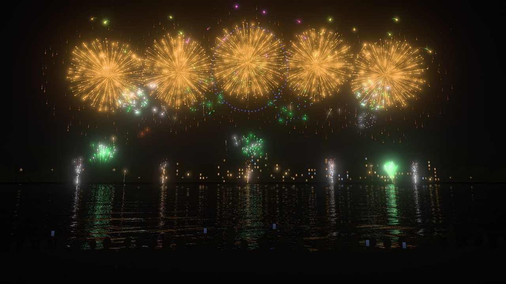
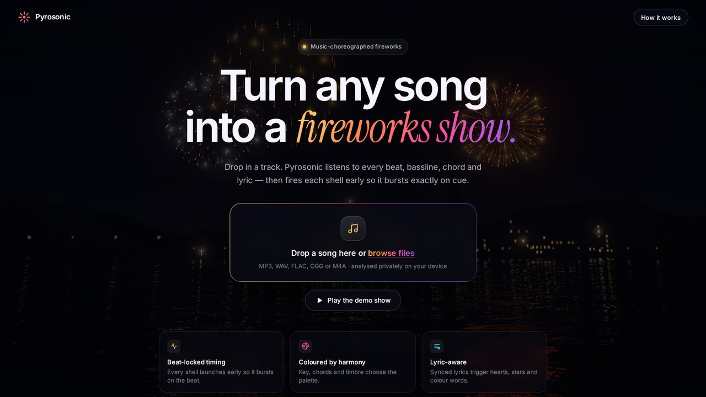
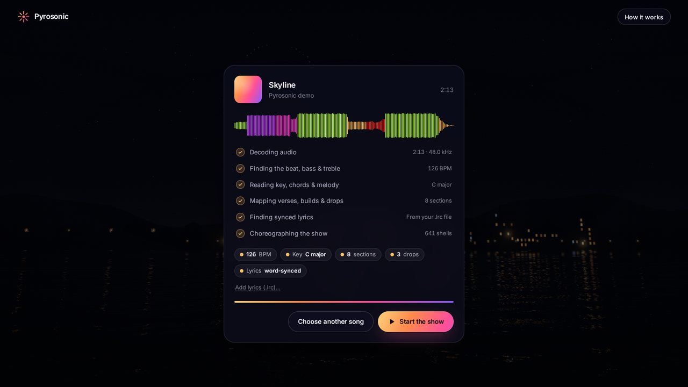
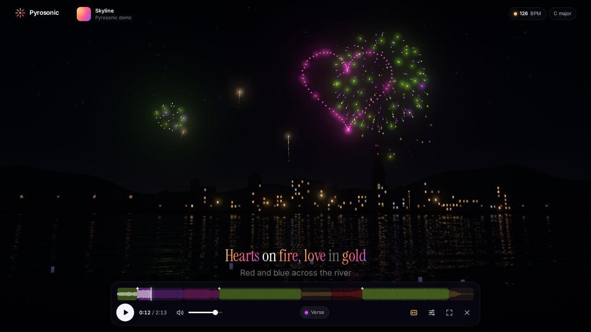

# Pyrosonic — turn any song into a fireworks show

Drop in a song and Pyrosonic choreographs a fireworks display to it, the way a real pyromusical is designed. It listens to the beat, bass, treble, harmony, structure and lyrics, picks the right firework for each moment, and launches every shell early enough that it **bursts exactly on the beat**.

**[▶ Try it live](https://berserkerlan.github.io/pyrosonic/)** — press *Play the demo show*, or drop in a song of your own.



| Landing | Analysis | Lyric-aware shells |
| --- | --- | --- |
|  |  |  |

## Quick start

Requires **Node.js 22.12 or newer**.

```bash
npm install
npm run dev        # → http://localhost:5173
```

Drop an MP3, WAV, FLAC, OGG or M4A file on the page, or press **Play the demo show**.

Production build (a fully static site you can host anywhere):

```bash
npm run build      # outputs dist/
npm run preview    # serves dist/ locally to check it
```

`dist/` uses relative paths, so it works from any sub-folder. It must be served over HTTP(S) rather than opened from `file://`, because browsers block module workers there.

Every push to `main` runs the tests and deploys the build to GitHub Pages (`.github/workflows/deploy.yml`).

## What it does

**Listens to the whole track** (in a Web Worker, typically about 1 second per 3 minutes of audio):
- Bass, mids, treble, loudness and brightness, measured from roughly 10 ms spectra.
- Onsets per band: kick drums, snares/claps and hi-hats.
- Tempo and every beat (dynamic-programming beat tracker), plus bar lines/downbeats. Timing is accurate to about 3 ms on test material.
- Key, chords per bar and a rough melody line, from chroma features.
- Song structure: intro, verses, builds, choruses, drops, breakdown, final chorus and outro, using a self-similarity novelty curve combined with energy change points. It also detects the riser before a drop and the moment of silence just before it.

**Reads the lyrics:**
- Synced lyrics embedded in the file, an `.lrc` file you add, or a lookup on [LRCLIB](https://lrclib.net), which is free and supports word-level timing.
- Words such as *love, heart, star, fire, gold, rain, sky, night, boom, rainbow* trigger matching shells (heart shapes, star shapes, golden kamuro and so on) at the moment they're sung. Colour words ("red", "blue"…) recolour that line of the show.
- Karaoke-style captions highlight each word as it's sung.

**Choreographs the show** across layers, like a human designer would:

| Musical moment | Firework |
| --- | --- |
| Downbeats | Peony / chrysanthemum fans; willows and kamuro for sustained, dark sections |
| Backbeat snares and claps | Crossettes, strobes, crackle |
| Hi-hats | Low glitter bursts |
| Kicks (loud sections) | Ground mines |
| Builds | Comets that rise, accelerate and converge, then darkness during the pre-drop silence |
| Drops | Salute flash, a five-shell fan and a line of mines |
| Calm, melodic passages | Comets whose height follows the melody and colour follows the pitch |
| Final chorus | Barrage ending in golden crowns |

Colours come from real pyrotechnic chemistry (strontium red, barium green, copper blue…), chosen from the key and chords around the circle of fifths. Repeated choruses reuse their palette, and the final one escalates.

**Renders it live** on the GPU with Three.js. Every star's trajectory (gravity plus air drag) is evaluated analytically in the shaders, which has three consequences:
- Pause freezes the sky mid-burst.
- Seeking is instant and exact.
- Tens of thousands of trailing stars hold 60 fps, even on an integrated GPU.

The scene is lit the way a real fireworks night looks:
- **Crisp stars.** Each star is a sharp point with a thin, tapering trail. Bloom is weighted towards its tightest levels, so bright stars glow without fogging the sky.
- **A dark sky.** The sky is near-black overhead, with a faint navy horizon and a dim glow above the town. A neutral tone curve keeps the shadows dark instead of lifting them to grey, and auto-exposure eases down during a busy finale.
- **A real river.** A mirror camera renders the whole scene from below the water. Travelling waves break that reflection up, so each light stretches into a long, shimmering streak. Fresnel makes the far water a near-mirror and the near water dark, and bursts leave glints on the ripples.

The show clock follows the audio output timestamp, compensating for output latency, so bursts land when you *hear* the beat.

## Using it

| Key | Action |
| --- | --- |
| Space / K | Play / pause |
| ← / → | Seek 5 s (J / L: 10 s) |
| ↑ / ↓ | Volume |
| F | Fullscreen |
| M | Mute |
| C | Lyric captions |
| H | Hide the interface |

The **Settings** panel (sliders icon) offers:
- **Intensity**: Calm, Balanced or Spectacular.
- **Scene**: crowd silhouettes and camera drift.
- **Reduce flashing**: softer bursts and no strobes, for photosensitive viewers.
- **Pyrotechnic sound effects**: booms and crackles, scheduled on the beat.
- **Lyrics**: captions, online lookup, and loading an `.lrc` file.
- **Quality**: Auto drops down by itself if frames slow.
- **A/V offset**: useful with Bluetooth headphones.

## Privacy

Audio is decoded and analysed entirely in your browser and is never uploaded. The only network request is the optional lyrics lookup, which sends **only the track title, artist and duration** to lrclib.net. You can switch it off under Settings → *Find lyrics online*.

## Project layout

```
src/
  analysis/   FFT, spectral features, beat tracking, key/chords, structure, worker
  show/       choreographer, firework physics & particle builders, palettes, runner
  render/     Three.js engine, GPU particle system (shaders), sky, scenery, water
  audio/      playback clock, metadata/cover art, pyro sound effects
  lyrics/     LRC + LRCLIB parsing, keyword → effect cues
  ui/         timeline, lyric captions, DOM helpers, icons
  app.js      app controller (views, file handling, render loop)
scripts/      procedural demo-track synthesiser
tests/        node:test suites (analysis accuracy, choreography invariants, lyrics)
public/demo/  the generated demo track
```

## Tests

```bash
npm test
```

The suites check:
- FFT correctness.
- Tempo and beat accuracy across 92–140 BPM at 44.1 and 48 kHz.
- That the analyser finds the demo track's real builds, pre-drop silences and drops.
- Choreography invariants: deterministic, sorted, beat-aligned, dark during blackouts, lyric cues honoured.
- Finite particles for every firework type and variant.
- Edge cases: silence, noise, pure tones, very short clips.
- The lyric parsers.

## Demo track

`public/demo/skyline.mp3` is an original piece, synthesised from code by `scripts/demo-synth.js`. Its arrangement deliberately covers everything the show reacts to: intro, verse, snare-roll build with a riser, pre-drop silence, drop, breakdown, a second build, final drop and outro. To regenerate it (requires `ffmpeg`):

```bash
node scripts/build-demo.js
```

## Browser support

Recent Chrome, Edge, Firefox and Safari: WebGL 2, Web Audio and module workers are required. Decoding support for FLAC/OGG/M4A depends on the browser; MP3 and WAV work everywhere.

If the graphics driver resets mid-show (some browser, driver and compositor combinations on Linux do this under heavy WebGL load), the music pauses and the show picks up where it left off once the browser restores graphics. If the browser keeps 3D graphics blocked, Pyrosonic offers to reload the page.

## Credits

[three.js](https://threejs.org) (MIT), [music-metadata](https://github.com/Borewit/music-metadata) (MIT), [js-yaml](https://github.com/nodeca/js-yaml) (MIT), Inter and Instrument Serif fonts (SIL OFL) via Fontsource, and synced lyrics from [LRCLIB](https://lrclib.net).
